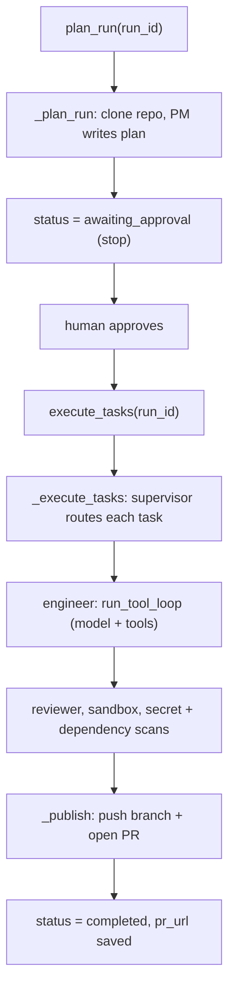

# How an Agent Run Works (code walk)

This traces one real run, the one that opened
[PR #2](https://github.com/aayushraj1425/Test_ASEP/pull/2) on Test_ASEP, through
the actual engine code. Every file is a link, with the line number of the
function, so you can open each one as you read.

The whole system is really one small loop repeated for each role. Everything
else is setup around that loop. Keep that in mind and the rest falls into place.

> How to read this: follow the links top to bottom. Each phase names the exact
> function that runs next, so you are always walking forward through real code.

## The example

- Request: "Add a string utilities module with `reverse`, `is_palindrome`,
  `count_vowels`, plus pytest tests."
- Result: the engine planned it, wrote the code, tested it in a sandbox, scanned
  it, and opened a pull request on its own. Total model cost: about two cents.

## The shape



Two entry points drive everything, both in
[`agents/runner.py`](../apps/engine/src/engine/agents/runner.py):
[`plan_run` (L176)](../apps/engine/src/engine/agents/runner.py#L176) and, after
approval, [`execute_tasks` (L187)](../apps/engine/src/engine/agents/runner.py#L187).
The `/runs` page calls these through
[`api/runs.py`](../apps/engine/src/engine/api/runs.py); the
[`run_agent_demo.py`](../run_agent_demo.py) script calls them directly. Same two
functions either way.

## Phase 1: Planning

Function: [`_plan_run` (runner.py L218)](../apps/engine/src/engine/agents/runner.py#L218).

1. It clones your repository into a private per-run folder and makes a branch.
   That is
   [`create_workspace` (workspace/manager.py L85)](../apps/engine/src/engine/workspace/manager.py#L85),
   which runs `git clone` and sets the commit identity to "ASEP Agent Team"
   (that is why the PR commits are authored by that name, not you).
2. It calls the Product Manager agent,
   [`create_plan` (product_manager.py L72)](../apps/engine/src/engine/agents/product_manager.py#L72),
   which returns a summary and a list of tasks.
3. It saves each task as an
   [`AgentTask` row (db/models.py L151)](../apps/engine/src/engine/db/models.py#L151)
   and sets the run to `awaiting_approval`, then stops. Nothing runs without a
   human yes.

For this run the plan was two backend tasks: write the module, write the tests.

## Phase 2: Approval

A person clicks Approve (the demo script flips the status in code). This writes a
`plan.approved` event and moves the run to `executing`.

## Phase 3: Execution and routing

Function: [`_execute_tasks` (runner.py L308)](../apps/engine/src/engine/agents/runner.py#L308).

1. It reopens the Phase 1 workspace with
   [`load_workspace` (manager.py L152)](../apps/engine/src/engine/workspace/manager.py#L152).
2. It builds a supervisor,
   [`build_supervisor_graph` (supervisor.py L141)](../apps/engine/src/engine/agents/supervisor.py#L141),
   and runs it. The supervisor uses no AI. It just picks the next task whose
   dependencies are done and hands it to an engineer, retrying up to
   [`MAX_RETRIES` (L27)](../apps/engine/src/engine/agents/supervisor.py#L27).

## Phase 4: The engineer writes the code (the heart)

Each task goes to
[`execute_task` (engineer.py L21)](../apps/engine/src/engine/agents/engineer.py#L21),
which builds two messages (a system prompt and the task text) and calls the
shared loop,
[`run_tool_loop` (loop.py L67)](../apps/engine/src/engine/agents/loop.py#L67):

```python
for _ in range(MAX_TURNS):                      # up to 24 turns
    turn = await model_router.complete_with_tools(spec.model_tier, messages, tools)
    messages.append(turn.message)
    if not turn.tool_calls:
        return turn.content or ""               # no tool call means the agent is done
    for call in turn.tool_calls:
        result = await call_tool(ws, spec.tools, call.name, call.arguments)
        messages.append({"role": "tool", "tool_call_id": call.id, "content": result})
```

Read that slowly. It is the whole agent idea in nine lines:

- The model is given the task and a list of tools it may use. The allow-list
  comes from
  [`registry.py` (engineer tools, L48)](../apps/engine/src/engine/agents/registry.py#L48).
- Each turn, the model either calls a tool or says it is done (a reply with no
  tool call).
- When it calls `write_file`, that is a real function,
  [`write_file` (tools.py L73)](../apps/engine/src/engine/agents/tools.py#L73).
  This is the moment `string_utils.py` was created. The model chose the
  contents; the engine just wrote them.
- Then it calls
  [`git_commit` (tools.py L336)](../apps/engine/src/engine/agents/tools.py#L336).
- The result of each tool goes back into the messages, so the model sees what
  happened and continues.

Every tool call passes through one gate,
[`call_tool` (tools.py L513)](../apps/engine/src/engine/agents/tools.py#L513):
it refuses any tool not on the agent's allow-list, and forces every file path
through the workspace jail,
[`_safe` (tools.py L359)](../apps/engine/src/engine/agents/tools.py#L359), so an
agent can never touch anything outside its clone. That is the safety model in
one function. The full toolbox and the schemas the model sees are the
[`TOOLS` table (tools.py L379)](../apps/engine/src/engine/agents/tools.py#L379).

The `agent.tool_call tool=write_file` lines you see in the logs are this loop
running.

## Phase 5: The gates

Back in `_execute_tasks`, after the tasks finish, four checks run in order. Any
one failing ends the run before a pull request opens.

1. [`review_run` (reviewer.py L45)](../apps/engine/src/engine/agents/reviewer.py#L45):
   a Reviewer agent reads the diff and may send it back for one revision round.
2. [`run_sandbox` (sandbox/runner.py L170)](../apps/engine/src/engine/sandbox/runner.py#L170):
   the tests run in a throwaway Docker container. This is the `sandbox.passed`
   log line.
3. A secret scan and a dependency scan on the diff.

## Phase 6: Opening the pull request

Function: [`_publish` (runner.py L422)](../apps/engine/src/engine/agents/runner.py#L422).
Two steps, both using your `GITHUB_TOKEN`:

1. [`push_branch` (manager.py L121)](../apps/engine/src/engine/workspace/manager.py#L121)
   pushes the branch to GitHub.
2. [`open_pull_request` (github.py L120)](../apps/engine/src/engine/github.py#L120)
   makes one REST call, `POST /repos/{owner}/{repo}/pulls`.

Then `runner.py` saves the PR URL on the run and sets it to `completed`.

## The one idea to keep

The whole platform is the nine-line loop in
[`loop.py`](../apps/engine/src/engine/agents/loop.py#L67), run once per role. The
Planner, Engineer, and Reviewer are the same loop with a different prompt, a
different model tier, and a different tool allow-list. All three of those come
from one table in
[`registry.py`](../apps/engine/src/engine/agents/registry.py).

## Where your two original goals live

- **Different models for different agents (cheap for coding, strong for
  planning).** The tier per role is set in
  [`registry.py`](../apps/engine/src/engine/agents/registry.py), and tiers map to
  real models in
  [`ModelRouter.resolve` (router.py L113)](../apps/engine/src/engine/llm/router.py#L113).
  Change one line in the registry and a role swaps models.
- **A record of why each change was made.** Every step writes an
  [`AgentEvent` row (db/models.py L173)](../apps/engine/src/engine/db/models.py#L173),
  and a ping on Redis through
  [`publish_run_ping` (events/bus.py L59)](../apps/engine/src/engine/events/bus.py#L59)
  wakes the live timeline. That event stream is your decision trail.

## Map of files in this walk

| File | Its job here |
| --- | --- |
| [`agents/runner.py`](../apps/engine/src/engine/agents/runner.py) | The spine: drives planning, execution, gates, publish |
| [`agents/product_manager.py`](../apps/engine/src/engine/agents/product_manager.py) | Planner agent: turns a request into a task list |
| [`agents/supervisor.py`](../apps/engine/src/engine/agents/supervisor.py) | Deterministic routing of tasks by dependency order |
| [`agents/engineer.py`](../apps/engine/src/engine/agents/engineer.py) | Runs one task through the shared loop |
| [`agents/loop.py`](../apps/engine/src/engine/agents/loop.py) | The nine-line model-and-tools loop (the heart) |
| [`agents/tools.py`](../apps/engine/src/engine/agents/tools.py) | The toolbox: write_file, git_commit, the jail, the allow-list |
| [`agents/registry.py`](../apps/engine/src/engine/agents/registry.py) | Per-role prompt, model tier, and tool policy |
| [`agents/reviewer.py`](../apps/engine/src/engine/agents/reviewer.py) | Reviewer agent: approves or asks for changes |
| [`llm/router.py`](../apps/engine/src/engine/llm/router.py) | The single gateway to every model; maps tiers to models |
| [`sandbox/runner.py`](../apps/engine/src/engine/sandbox/runner.py) | Runs the tests in a throwaway Docker container |
| [`github.py`](../apps/engine/src/engine/github.py) | Pushes and opens the pull request over the REST API |
| [`workspace/manager.py`](../apps/engine/src/engine/workspace/manager.py) | Clones the repo, jails edits, pushes the branch |
| [`events/bus.py`](../apps/engine/src/engine/events/bus.py) | Wakes the live timeline when an event is written |
| [`db/models.py`](../apps/engine/src/engine/db/models.py) | The AgentRun, AgentTask, and AgentEvent tables |
| [`api/runs.py`](../apps/engine/src/engine/api/runs.py) | The HTTP entry point the UI uses to start a run |
| [`run_agent_demo.py`](../run_agent_demo.py) | Start a real run from the terminal |
