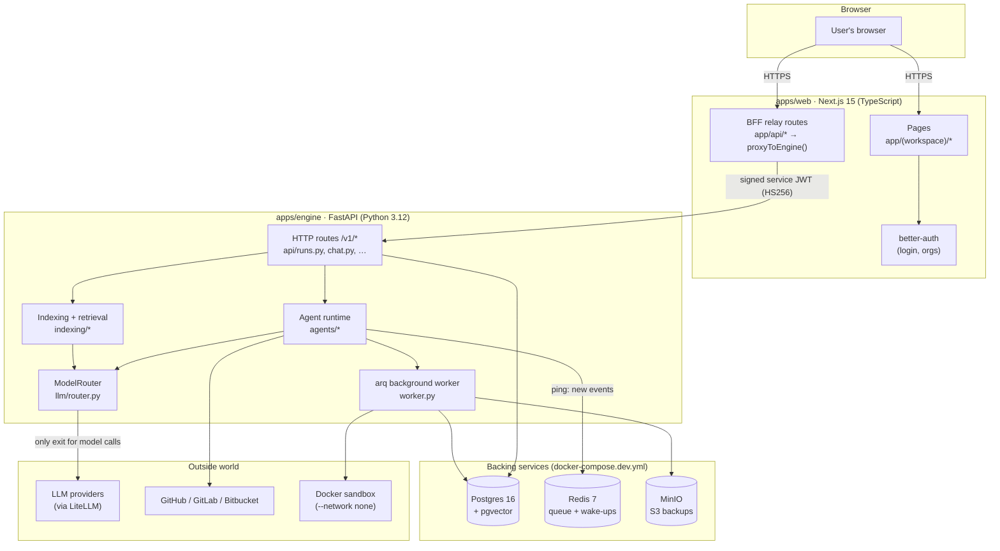
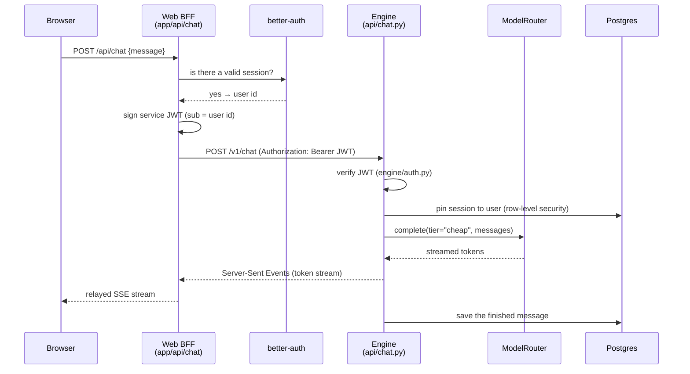
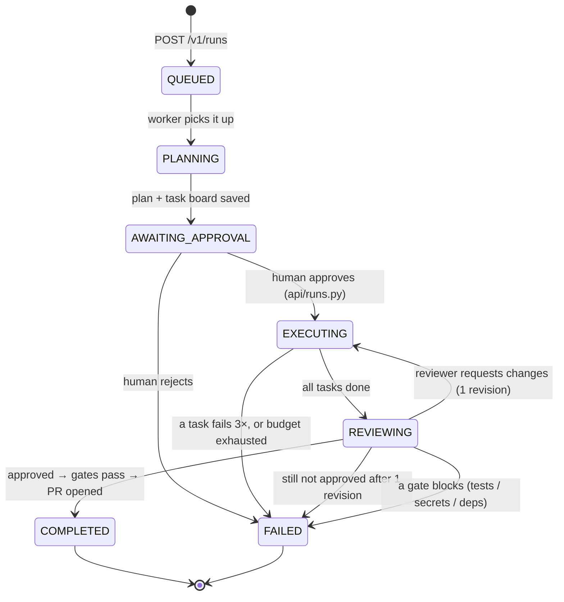
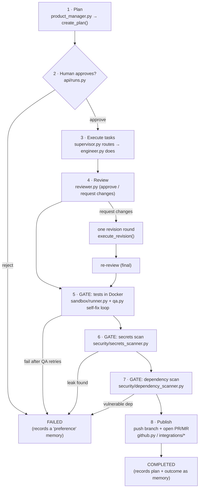
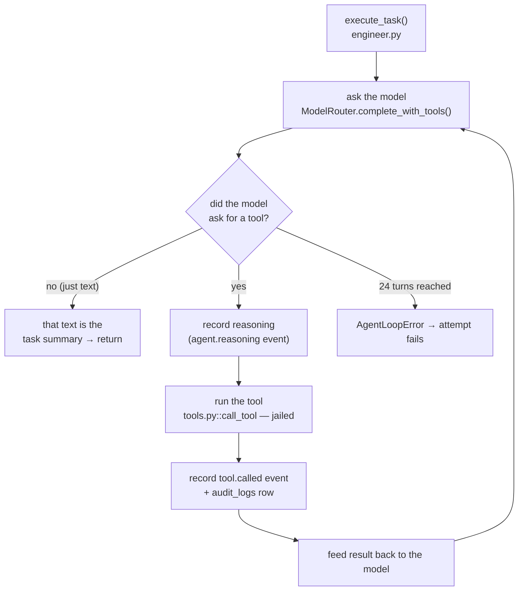
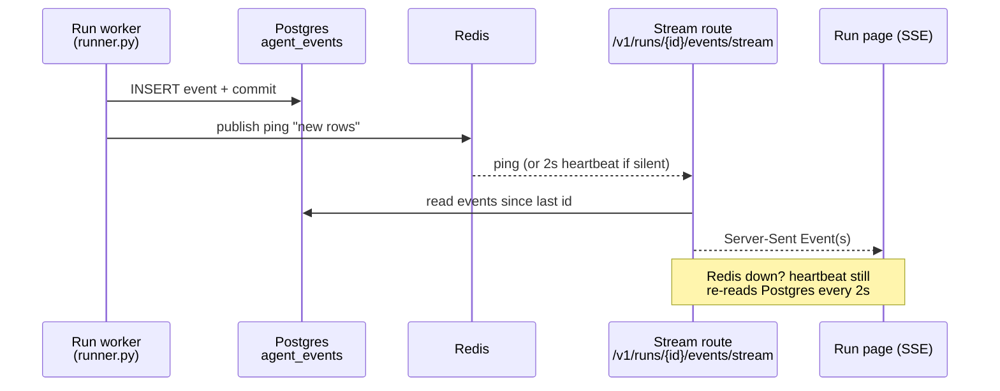
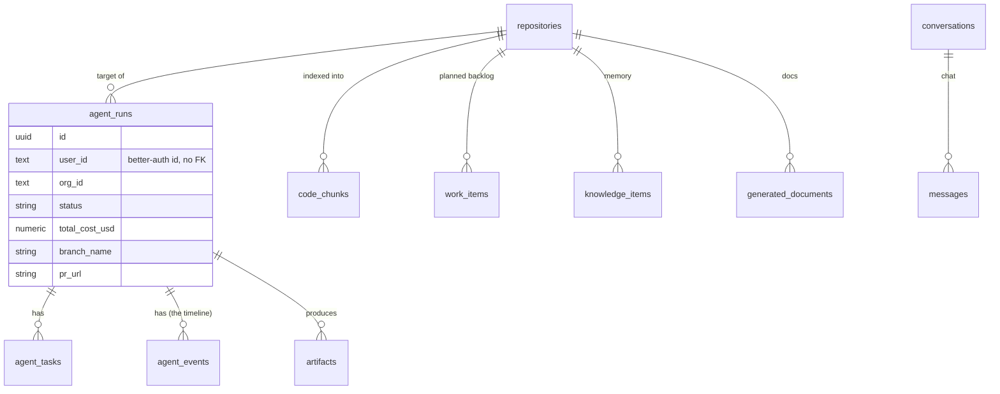

# Architecture Diagrams

Visual companion to [CODE_TOUR.md](CODE_TOUR.md) (where the code lives) and
[HOW_IT_WORKS.md](HOW_IT_WORKS.md) (what the product does). Every diagram here is
grounded in real files — the file names are clickable in your editor.

---

## 1. The whole system (containers)

Who talks to whom, and what each part is made of. The browser only ever talks
to the web app; the engine is never reachable directly.

**The one rule to remember:** the browser → web app → (signed JWT) → engine.
The engine trusts a request only if it carries a JWT signed with
`ENGINE_SERVICE_SECRET` (checked in `engine/auth.py`). `/healthz` is the only
public route.

---

## 2. Request flow — a plain chat message

The simplest end-to-end path. Good to trace first because it touches every
layer once.

Key idea: the web app never holds a model key or talks to a provider. It only
proves *who you are* and forwards. All intelligence lives behind the JWT.

---

## 3. The agent run — state machine

A run is a state machine stored in the `agent_runs.status` column. Every arrow
is a transition written to the `agent_events` table, which *is* the timeline you
see on the run page.

The human approval gate between `AWAITING_APPROVAL` and `EXECUTING` is the
safety line: no code is written until you approve the plan. Everything failure
flows through one function (`_fail_run` in `agents/runner.py`) so a run can never
end in a half-state.

---

## 4. The run pipeline — which file owns each step

This is the same order `agents/runner.py::_execute_tasks` calls things. Steps
5–7 are **gates**: any one of them failing fails the run and *no pull request
opens*.

---

## 5. Inside one task — the shared agent loop

Every engineer role (Backend, Frontend, DevOps, QA, Reviewer) uses the *same*
loop in `agents/loop.py::run_tool_loop`. Only three things differ per role, all
from `agents/registry.py`: the **system prompt**, the **model tier**, and the
**allowed tools** (deny-by-default).

Two safety limits live here: **MAX_TURNS = 24** (a task can't loop forever) and
every file path passes through the **jail** (`workspace/jail.py`) before any read
or write. `LLM_FAKE=1` swaps the model for deterministic canned steps, so this
whole loop is testable offline.

---

## 6. Live timeline — how the UI updates without polling hard

The clever bit (`events/bus.py`): **Postgres holds the events, Redis only says
"go look".** A Redis ping carries no data. If Redis is down, a 2-second
heartbeat re-reads Postgres anyway — so you lose a little latency, never an
event.

---

## 7. The data model (the tables that matter)

Notes that explain the shape:
- **`user_id` / `org_id` are plain text, not foreign keys.** Identity lives in
  better-auth's own tables (created by a separate migration), and the engine
  only references the ids — see the CLAUDE.md conventions.
- **Row-level security** is enforced *inside Postgres* on the ownership-carrying
  tables, so even raw SQL on an API session can't read another user's rows
  (`db/rls.py`, `db/visibility.py`).
- **`code_chunks`** holds `vector(768)` embeddings via pgvector — data and
  vectors in one store (ADR-0003), no separate vector database.

---

## How to use these diagrams

Pair each with the code:

| Diagram | Read alongside |
|---|---|
| 1 · Containers | `CLAUDE.md`, the ADRs in `docs/architecture/adr/` |
| 2 · Chat flow | `apps/web/src/app/api/chat/route.ts`, `engine/api/chat.py` |
| 3 · Run states | `engine/db/enums.py` (`RunStatus`), `engine/agents/runner.py` |
| 4 · Run pipeline | `engine/agents/runner.py::_execute_tasks` (top to bottom) |
| 5 · Agent loop | `engine/agents/loop.py`, `engine/agents/registry.py` |
| 6 · Timeline | `engine/events/bus.py`, `engine/api/runs.py` (stream route) |
| 7 · Data model | `engine/db/models.py` |
