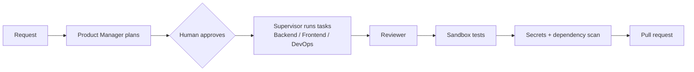
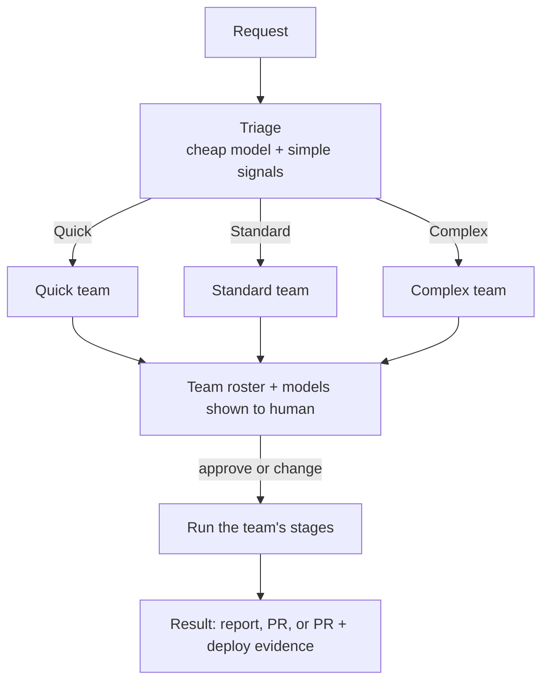
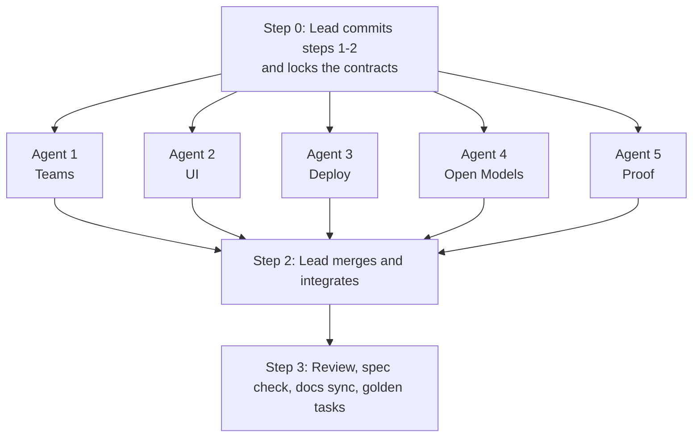

# Plan: Adaptive Agent Teams

Implementation update (2026-11-17): all five implementation workstreams are
committed and integrated; offline verification and documentation are complete. Live
provider, preview-cluster and local-model checks are deferred at the user's
request. See [Running adaptive teams](architecture/agents/ADAPTIVE_TEAMS.md) for
setup and reproducible checks, and [ADR-0011](architecture/adr/0011-adaptive-teams-and-seat-models.md)
for accepted decisions. Model names below describe the original proposal; runtime
defaults remain the configured ids until an operator supplies a catalog.

**Status:** Runnable implementation verified; live validation deferred · **Date:** 2026-11-17 · **Phase:** Phase 9: Adaptive Agent Teams

## What we want

1. **A team per task.** Every run gets its own group of agents, picked for that task.
2. **Right-sized teams.** An easy task (run the tests for a feature) gets one or two agents. A hard task (build a feature, deploy it, test it in the cloud) gets the full team.
3. **A model per agent.** Each seat on the team gets its own model, for example Fable for the Principal Engineer, Opus for a Senior Engineer, Sonnet for an Engineer. Today the platform picks automatically from Claude models. Later it can pick open source models too.

## Where we are today

Every run goes through the same fixed pipeline, no matter how small the request is.

The pieces that matter for this plan:

| Piece | File | Today |
|---|---|---|
| Roles and their model | [registry.py](../apps/engine/src/engine/agents/registry.py) | Each role has a fixed tier: `planner`, `coder` or `cheap` |
| Tier to model | [router.py](../apps/engine/src/engine/llm/router.py) `ModelRouter.resolve` | Three env vars: `MODEL_PLANNER`, `MODEL_CODER`, `MODEL_CHEAP` |
| The pipeline | [runner.py](../apps/engine/src/engine/agents/runner.py) `_plan_run`, `_execute_tasks` | Every stage always runs |
| Task routing | [supervisor.py](../apps/engine/src/engine/agents/supervisor.py) | Deterministic, by dependency order. Keep this. |
| Provider keys | [keys.py](../apps/engine/src/engine/llm/keys.py) | `anthropic`, `openai`, `gemini` only |
| Budget cap | `AgentRun.max_cost_usd` in [models.py](../apps/engine/src/engine/db/models.py) | Already enforced per run |

So the gaps are: one team shape for all work, models chosen per role instead of per seat, no cloud deploy step, and no open source providers.

## The new flow

Three new ideas carry the whole plan: **triage**, **team templates**, and **seats**.

### 1. Triage: how hard is this task?

A new step before planning. It reads the request and returns `quick`, `standard` or `complex` with a short reason.

It uses two kinds of evidence:

- **Rules first** (free and predictable). Words like "deploy", "migrate", "infrastructure", "cloud" push toward complex. Words like "test", "check", "explain", "rename" push toward quick. The repository index ([Phase 2](ROADMAP.md)) tells us how many files and services the request likely touches.
- **A cheap model second**, only when the rules are unsure.

Safety nets:

- The human sees the triage result on the approval screen and can change it.
- **Escalation:** if a quick run's plan turns out to need more than 2 tasks, or an agent fails twice, the run moves up one level instead of failing.
- Every triage decision is an `AgentEvent` (`run.triaged`), so it shows on the timeline.

### 2. Team templates: which agents and which stages

A template lists the seats on the team and the stages the run goes through. Templates live in config, the same way roles live in `registry.py` today, so adding one never touches runtime code.

| Template | Example request | Seats | Stages | Output |
|---|---|---|---|---|
| **Quick** | "Run the tests for the login feature and tell me what fails" | 1 Engineer (or QA alone for test-only) | sandbox tests | report, PR only if code changed |
| **Standard** | "Add a dark mode toggle" | Product Manager, Engineers, Reviewer | today's full pipeline | PR |
| **Complex** | "Add billing, deploy it, test it on cloud" | Principal Engineer, Product Manager, Senior + regular Engineers, Reviewer, QA, Release Engineer | design note, plan, build, review, sandbox, scans, **preview deploy**, **cloud tests** | PR + deploy evidence |

What changes in the pipeline: `_execute_tasks` stops calling every gate in a fixed order and instead walks the template's stage list. The gates themselves (`_sandbox_gate`, `_security_gate`, `_dependency_gate`) stay as they are. Security and secret scans stay on for every template that opens a PR; they are cheap and only Quick test-only runs skip them because nothing is published.

### 3. Seats: a role plus a level

Today a role (backend, frontend) is tied to one tier. We split that into a **seat**: role + level.

- **Role** still decides tools and prompt (unchanged, [ADR-0008](architecture/adr/0008-agent-tool-security-model.md) still applies).
- **Level** decides the model and how much the seat is trusted with.

| Level | What it does | Default Claude model |
|---|---|---|
| Principal Engineer | Writes the design note on complex runs, reviews the final diff | Fable 5.2 (`claude-fable-5-2`) |
| Senior Engineer | Takes the hardest tasks on the board, cross-service changes | Opus 5.5 (`claude-opus-5-5`) |
| Engineer | Normal tasks | Sonnet 5.5 (`claude-sonnet-5-5`) |
| Support (triage, supervisor notes, summaries) | Small judgement calls | Haiku 5.5 (`claude-haiku-5-5`) |

The Product Manager decides which level each task needs when it writes the board (a new `level` field in the plan JSON). The supervisor still routes by dependency order. Nothing about routing becomes an LLM call.

## Model selection

### Now: auto-select from Claude

A **model catalog** replaces the three env vars as the source of truth. Each entry says:

- model id, provider, context size, supports tool calls (yes/no)
- rough strength (1 to 5) and cost per million tokens
- open source (yes/no)

The **selection rule** for a seat, in order:

1. A model the human pinned for this seat on the approval screen.
2. A model the organization pinned for this level in settings.
3. **Auto:** the cheapest catalog model whose strength meets the level's minimum, that supports tool calls, and that the caller has a key for.
4. If the run's remaining budget can't cover it, drop one level and record why.

If a model is rate limited or down, the router falls back to the next model in the same strength band, not straight to a weaker one. The existing retry logic in `_call_with_retries` stays.

Every pick is logged as a `model.selected` event with the reason ("auto: cheapest at strength 4", "pinned by org"), so the decision trail answers "why did this agent use this model?".

`ModelRouter` stays the only place that talks to LiteLLM ([ADR-0006](architecture/adr/0006-litellm-model-router-and-cost.md)). It gains `resolve_seat(level, overrides, budget)` next to the old `resolve(tier)`. The `Tier` names keep working during the move so nothing breaks at once.

### Later: open source models

1. Add an `openai_compatible` provider (covers Ollama, vLLM, LM Studio) with a base URL per entry. LiteLLM already speaks this.
2. Add it to `ALLOWED_PROVIDERS` in [keys.py](../apps/engine/src/engine/llm/keys.py) so users can bring their own endpoint.
3. **Eval gate:** a new model only joins auto selection after it passes the golden tasks in [EVALUATION.md](EVALUATION.md), tool calls included. Until then it can only be pinned by hand. Its strength score comes from those results, not guesses.
4. A per-organization switch: "allow open source models in auto".

## Cloud deploy and cloud testing (Complex template)

This is the biggest new capability, so it ships last.

- A new **Release Engineer** seat (DevOps tools + a deploy tool).
- Deploys to a **preview environment** only, never production. First target: a Kubernetes preview namespace using the Helm setup we already have; other clouds later.
- A **second human approval** before anything is deployed.
- Cloud credentials are stored like provider keys (encrypted, per org) and are only handed to the deploy tool, never to the model.
- After deploy, QA runs smoke tests against the preview URL. The results and the URL go into the PR body.
- The preview environment is torn down when the PR merges or after a time limit.

## Data and API changes

- **Migration:** `AgentRun` gets `complexity`, `team_template`, `team` (JSON roster with seat, level, model). `AgentTask` gets `level` and `model`.
- **New events:** `run.triaged`, `team.assembled`, `model.selected`, `run.escalated`, `deploy.started`, `deploy.finished`.
- **API:** `POST /v1/runs` accepts an optional `complexity` and seat overrides. A new `GET /v1/models` returns the catalog. Run `pnpm generate` after.
- **UI:** the approval screen shows the triage result, the team roster and each seat's model, all editable. The timeline shows the new events.
- **ADR:** a new ADR, "Adaptive teams and per-seat model selection", which amends ADR-0006.

## Delivery order

Each step ships on its own and leaves the platform working.

| # | Workstream | What ships | Done when |
|---|---|---|---|
| 1 | Model Catalog & Seat Selection | Catalog, `resolve_seat`, `model.selected` events, defaults reproduce today's behaviour | Existing tests pass unchanged; a run's timeline shows which model each agent used and why |
| 2 | Triage & Quick Team | Triage step, Quick template, escalation | "Run the tests for X" finishes with a single agent; a mislabelled quick run escalates instead of failing |
| 3 | Team Templates & Principal Engineer | Template-driven stages, levels on the board, Principal Engineer seat | A complex request produces a design note, then a board where tasks carry levels and models |
| 4 | Approval Screen Roster | Roster and model overrides in the UI | Human can change complexity or a seat's model before approving |
| 5 | Preview Deploy & Cloud Tests | Release Engineer, deploy tool, cloud smoke tests | A complex golden task ends in a PR with a live preview URL and passing smoke tests |
| 6 | Open Source Models | `openai_compatible` provider, eval gate, org switch | A local Ollama model passes the golden tasks and can be picked by auto |

## How we build it: five agents in parallel

We build the remaining workstreams at the same time with five Claude Code agents, each in its own git worktree. The table above shows what depends on what. Parallel work is safe because the shared pieces get locked first, and every agent then builds against those fixed pieces instead of waiting for someone else's code.

### Where the build stands (2026-11-17)

The initial Model Catalog & Seat Selection and Triage & Quick Team implementation
was committed before the five worktrees started. The paths below are the original
foundation; the sections after them describe the parallel build procedure.

- [llm/catalog.py](../apps/engine/src/engine/llm/catalog.py) (`SeatLevel`, `ModelEntry`, `ModelSelection`) and `ModelRouter.resolve_seat` in [router.py](../apps/engine/src/engine/llm/router.py)
- [agents/triage.py](../apps/engine/src/engine/agents/triage.py) (`Complexity`, `classify_request`, `template_for`), plus escalation in [runner.py](../apps/engine/src/engine/agents/runner.py)
- `GET /v1/models` in [api/models.py](../apps/engine/src/engine/api/models.py)
- Migration [0026_run_triage.py](../apps/engine/src/engine/migrations/versions/0026_run_triage.py) and [ADR-0011](architecture/adr/0011-adaptive-teams-and-seat-models.md)
- Design notes [MODEL_CATALOG.md](architecture/agents/MODEL_CATALOG.md) and [TRIAGE_AND_QUICK_RUNS.md](architecture/agents/TRIAGE_AND_QUICK_RUNS.md)

So the five agents build the four workstreams that are left, plus one agent that proves the whole thing works.

### Step 0: commit, then lock the contracts (lead, before any agent starts)

A worktree starts from a commit, not from the working tree. If the work above isn't committed, none of the five agents will see it.

1. **Commit the finished steps 1 and 2** after the full engine and web suites pass.
2. **Add the migration for the remaining columns** (migration 0027): `agent_runs.team` (JSON roster: seat, level, model) and `agent_tasks.level` and `agent_tasks.model`. Agents don't write migrations, so revision numbers can't collide.
3. **Add the shared types** in a new `agents/teams_types.py`: `Seat`, `TeamTemplate`, `StageName`, reusing `SeatLevel` and `Complexity` rather than redefining them.
4. **Add function stubs** that raise `NotImplementedError`, so other agents can build against them:
   - `deploy_preview(ws, credentials) -> PreviewDeployment`
   - `run_cloud_smoke_tests(url) -> SmokeResult`
5. **Fix the event list**: `team.assembled`, `deploy.started`, `deploy.finished` join the existing `run.triaged`, `run.escalated`, `model.selected`.
6. **Fix the API shape** for seat overrides on `POST /v1/runs`, then `pnpm generate` so the web types exist.
7. Commit all of it in one commit. All five worktrees start from there.

### Step 1: the five agents

Each agent owns a set of files. It may read anything, but it only edits what it owns. If it needs a change outside its files, it stops and reports to the lead instead of editing.

| Agent | Workstream | Owns (edits only these) | Builds against |
|---|---|---|---|
| **1. Teams** | Team Templates & Principal Engineer | `agents/runner.py`, `agents/registry.py`, `agents/supervisor.py`, `agents/product_manager.py`, new `agents/teams.py`, new role prompts in `agents/prompts/` | the step 0 types and stubs; it wires the deploy functions into the Complex template |
| **2. UI** | Approval Screen Roster | `apps/web/src/components/runs/`, the run approval screen, a new BFF route for models under `apps/web/src/app/api/` | the generated API types from step 0, fake data |
| **3. Deploy** | Preview Deploy & Cloud Tests | new `agents/release.py`, new `deploy/` package, new deploy functions in `agents/tools.py` (adding only, no edits to existing tools), Helm preview values under `infra/` | the `deploy_preview` and `run_cloud_smoke_tests` signatures |
| **4. Open Models** | Open Source Models | `llm/catalog.py`, `llm/router.py`, `llm/keys.py`, `config.py` model fields, `.env.example`, `api/models.py` | the existing `resolve_seat` behaviour; nothing new from others |
| **5. Proof** | Evaluation & Tests | `evaluation.py`, golden task fixtures, new tests under `apps/engine/tests/` and `apps/web/e2e/` | every contract; it writes tests against the step 0 signatures, so they fail until the other agents finish and pass once they do |

What Agent 5 builds, so it's clear what "proof" means:

- A complexity label on every golden task, and a triage accuracy check (target: 9 in 10).
- Cost per template from the existing LLM cost metrics.
- End to end tests for one quick, one standard and one complex run with `LLM_FAKE=1`.

`runner.py` is the file most likely to collide, so only Agent 1 edits it. Agent 3 hands over plain functions and Agent 1 calls them from the Complex template's stages.

**Rules every agent follows:**

- Work in its own worktree (`isolation: "worktree"`), branch named after its workstream.
- Tests run with `LLM_FAKE=1`; anything another agent owns is faked behind the step 0 signature.
- Before reporting done: `uv run ruff format .`, `uv run ruff check .`, `uv run pyright`, `uv run pytest` for engine work, `pnpm --filter web lint typecheck test` for web work.
- Write the design note under `docs/architecture/` for its workstream before coding it.
- Report back: what changed, test results, anything left as a stub, any contract change it wishes it could make.

### Step 2: merge and integrate (lead)

Merge in dependency order so each merge lands on working code:

1. **Open Models** (touches only the model layer, so it lands cleanly first)
2. **Deploy** (fills in the stubs)
3. **Teams** (calls the real deploy functions)
4. **UI** (renders the roster and events Teams now emits)
5. **Proof** (its tests should now go green; any that don't point at the gap)

After each merge the lead runs the full engine and web test suites. A failing merge gets fixed before the next one.

### Step 3: check it (lead, using the project's agents)

- `code-reviewer` on the combined diff.
- `spec-checker` to confirm the result matches this plan.
- `doc-syncer` to update ROADMAP, BACKLOG and the architecture docs.
- Run the golden tasks with real models: one quick, one standard, one complex.
- Commit as a few large, reviewable commits, one per workstream.

### What can go wrong with parallel work

- **A contract turns out wrong.** An agent reports it rather than working around it. The lead updates the contract on `main` and the affected agents rebase.
- **Two agents need the same file.** The ownership table settles it; the non-owner sends the change request to the lead.
- **Cost.** Five agents at once spend tokens fast. Run them on Sonnet 5.5 and keep Opus 5.5 for the lead's integration and review work.

## How we'll know it works

- **Triage accuracy:** label each golden task with its expected complexity; triage should match at least 9 in 10.
- **Cost:** a quick run should cost well under a standard run. Track cost per template with the existing LLM cost metrics.
- **Quality:** pass rate on golden tasks does not drop compared with today's fixed pipeline.

## Risks

- **Triage gets it wrong.** Covered by human override and automatic escalation.
- **Fable and Opus are expensive.** The per-run budget cap already exists; selection drops a level before blowing the budget.
- **New models missing from LiteLLM's cost table.** The router already records cost as 0 instead of crashing; the catalog's own prices fill the gap.
- **Open source models are weaker at tool calls.** The eval gate keeps them out of auto until they prove themselves.
- **Deploy credentials.** Kept out of the model's reach, preview environments only, extra human approval.
- **Free-tier rate limits** make long complex runs fail midway. Fallback within the same strength band helps; real use needs a paid key.

## Resolved decisions

1. Kubernetes preview namespaces with Helm come first. Images must already be published; the adapter does not build or push them.
2. Quick test-only runs retain human plan approval.
3. Monthly organization budgets are deferred until durable concurrent spend reservations exist. Per-run caps remain active.

Live preview and local-model acceptance checks remain deferred by the user's
2026-11-17 instruction. Simulated results never satisfy those live criteria.
