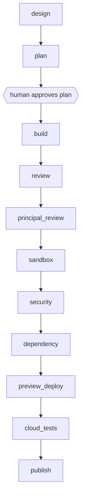
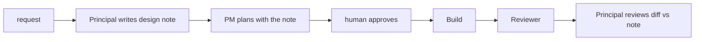
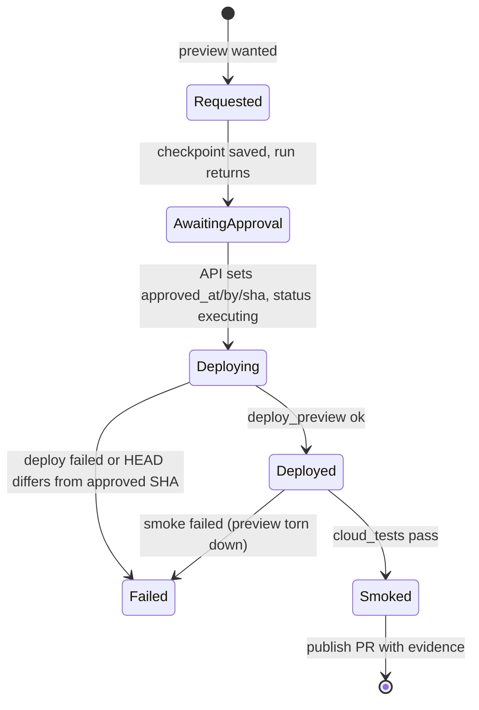

# Adaptive team runtime

This note covers delivery step 3 of [PLAN.md](../../PLAN.md) plus the runtime side of
the preview deploy step. It follows the fixed interfaces in
[ADAPTIVE_PARALLEL_CONTRACTS.md](ADAPTIVE_PARALLEL_CONTRACTS.md). The runner now walks
the stages of a team template instead of calling every gate in a fixed order.

## What changed in plain words

- Every run has a team template: `quick`, `test_report`, `standard` or `complex`.
  `agents/teams.py` holds the registry (`get_team_template`) and the roster builder
  (`assemble_run_team`).
- The runner reads the template's stage list and runs the stages that are not yet in
  `run.stages_completed`. After each stage it saves progress, so a restart picks up at the
  next stage.
- A **seat** is `role:level`. The Product Manager now gives every task a level
  (`engineer` or `senior`). The task's level and the chosen model are saved on the task row.
- Complex runs get a Principal Engineer. The Principal writes a design note before the
  plan and reviews the final diff against that note.
- Complex runs that ask for a cloud preview stop at a second human approval before anything
  is deployed.

## Stage order

| Template | Stages |
|---|---|
| quick | the Quick workstream's `quick_template()` stages (no review, scans stay on) |
| test_report | plan, test_report (no edits, no publish) |
| standard | plan, build, review, sandbox, security, dependency, publish |
| complex | design, plan, build, review, principal_review, sandbox, security, dependency, preview_deploy, cloud_tests, publish |

Scans run before the preview deploy and before any publish, so nothing leaks to a
cluster or a pull request before it is scanned. The review and principal review can
send one revision round, so the sandbox always runs after them.

Planning (design and plan) happens before approval in `plan_run`. Execution
(`execute_tasks`) runs everything after the plan. Escalation from Quick to Standard
re-reads the template after every stage, rebuilds the roster, and clears the sandbox
checkpoint because Standard tests again after review.

## Seats and models

`assemble_run_team(session, run)` builds the roster: the template's fixed seats plus one
seat per distinct `role:level` found on the task board. For each seat it calls
`ModelRouter.resolve_seat` with:

1. the human override for that seat key (`run.model_overrides`), passed as a pin for the level,
2. the organization's level pins from `OrganizationModelPolicy`,
3. `allow_open_source_auto` from the same policy,
4. the remaining run budget,
5. the run owner's provider keys, loaded for the call only (so a seat is "available" only if
   the owner has a key).

The result is saved on `run.team` (seat key, role, level, model, reason) and each task's
`model`. The runner resolves again for every agent call with the same inputs and the live
budget, then emits `model.selected`. Clearing the overrides restores auto selection.

## Complex runs: the Principal Engineer

- The design note is saved in `run.design_note` and shown through `design.created`.
- The Principal is read-only (`git_diff` and read tools). It never edits files.
- The final review returns the same verdict JSON as the Reviewer. One revision round, then
  a second verdict. Not approved means the run fails.
- With `LLM_FAKE=1` the note is a fixed text and the verdict is approve.

### Upgrading a planned run to Complex

When the human changes complexity to Complex after the plan exists, the lead's API moves the
run to `planning` and schedules `prepare_approval_team(run_id)`. It writes the missing
design note, keeps the board exactly as the human edited it (no tasks are deleted or
rewritten), rebuilds the roster, and returns the run to `awaiting_approval`. A failure
follows the normal guard and fails the run. For a change that needs no design the API calls
`assemble_run_team` directly.

## Preview deploy

- A preview is wanted when `run.preview_requested` is true, or when it is unset and the
  request mentions deploying, a preview or the cloud. Otherwise both stages are skipped with a
  `deploy.skipped` event.
- At `preview_deploy` with no approval, the runner writes the Release Engineer's readiness
  note, sets `awaiting_deploy_approval`, commits, and returns. Nothing deploys.
- After approval the runner checks `approved_at`, `approved_by` and that the workspace HEAD
  equals `deployment_approved_sha`. Any mismatch fails closed. Then it saves `deploying`
  (so a restart knows a deploy may have started) and calls the Deploy workstream's
  `deploy_preview`.
- The deploy adapter is idempotent per run (the namespace comes from the run id). The saved
  `preview_deployment` prevents a second deploy after recovery.
- Credentials are loaded and decrypted inside the runner step, passed straight to the
  adapter, and never go into prompts, tool results, events, logs or errors. Errors are
  scrubbed to a bounded message.
- A `simulated` deployment is labeled as simulated everywhere. The runner never calls the
  network smoke tests for it and never reports it as live.
- A failed smoke run tears the preview down and fails the run, so no pull request opens
  with failing evidence.
- The pull request body gets a Preview section: status (live or simulated), URL, expiry,
  deployed SHA, and the bounded smoke checks.
- Cleanup: `cleanup_run_preview` and `cleanup_expired_previews` (agents/preview_cleanup.py)
  do the work. `jobs.dispatch_preview_cleanup(run_id)` is the merge hook and the worker has a
  cron job for expiry.

## Recovery

`DEPLOYING` joins the resumable statuses next to `EXECUTING` and `REVIEWING`. A run waiting
in `awaiting_deploy_approval` is left alone, like one waiting for plan approval.
Stage checkpoints (`stages_completed`) mean a resumed run never repeats a finished stage, and
`run.pr_url` plus the `publish` checkpoint stop a second pull request.

## Events

New or extended: `team.assembled` (adds `seats`, keeps `roles`), `design.created`,
`stage.completed`, `release.readiness`, `deploy.approval_requested`, `deploy.skipped`,
`deploy.started`, `deploy.finished`, `cloud_tests.finished`. None contains credentials.

## Open integration points

- `quick_template` (Triage workstream), `deploy_preview`, `run_cloud_smoke_tests`,
  `teardown_preview` (Deploy workstream), `load_preview_credentials` and the cleanup
  helpers (lead) are imported for real. Unit tests stub them behind their signatures.
- `triage.template_for` must return `complex` for Complex runs. The runner uses
  `teams.template_name_for`, which the Triage workstream's function should match.
