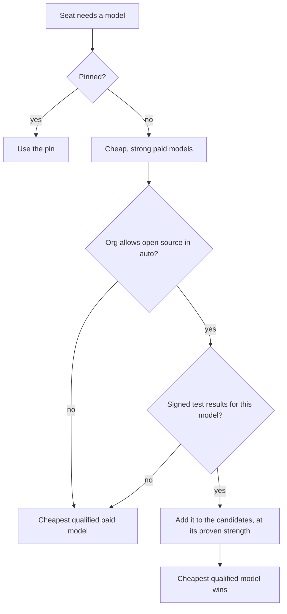

# Open source models

Part of the Open Source Models workstream in [PLAN.md](../../PLAN.md). It builds on
the [model catalog](MODEL_CATALOG.md) and the shared rules in
[ADAPTIVE_PARALLEL_CONTRACTS.md](ADAPTIVE_PARALLEL_CONTRACTS.md).

## What you get

You can point the platform at a local or self-hosted model (Ollama, vLLM, LM Studio)
and use it two ways:

1. **Pinned by hand.** Anyone can pin it to a seat. This was already allowed.
2. **Picked by auto.** The platform only does this when both are true:
   the organization switched on "allow open source models in auto", **and** the model
   has passed our own tests on this machine.



## Why a flag is not enough

`evaluated: true` in `MODEL_CATALOG` is just text someone typed. It proves nothing,
so the router ignores it for the auto decision. Instead the model has to earn a
**results file**:

```powershell
cd apps/engine
uv run python scripts/eval_open_model.py openai_compatible/qwen3-coder
```

The script runs two kinds of tests against the real model:

- **Tool call checks.** Four small probes: make one call, get argument types right,
  make several calls in a row, and do not call a tool when none is needed.
- **The three golden tasks** from [EVALUATION.md](../../EVALUATION.md), through the
  real pipeline, with every seat pinned to the candidate model.

Every check must pass, including "the diff really contains the change". Then the
script writes a results file, signed with the engine's service secret. The router
trusts a file only if all of these hold:

| Check | Why |
|---|---|
| The signature matches | A hand-edited file fails |
| Same model id and same endpoint URL | Changing the endpoint needs a new test run |
| Same golden tasks and same probes as today | If we change the tests, old results expire |
| Not produced offline (`LLM_FAKE`) | A fake run cannot certify anything |
| Younger than `MODEL_EVALUATION_MAX_AGE_DAYS` | Models and servers drift |
| Every task and probe passed | No partial credit |

The strength the model may fill in auto is **capped by the results**, not by the
number the operator typed. Passing everything proves strength 3 (engineer work).
It never unlocks senior or principal seats on its own.

Nothing here claims a live run passed. The unit tests use stub providers. Only you
can run the script against a real Ollama or vLLM server.

## Configuration

A catalog entry for a local model:

```json
{
  "id": "openai_compatible/qwen3-coder:30b",
  "provider": "openai_compatible",
  "base_url": "http://localhost:11434/v1",
  "context_size": 32768,
  "supports_tools": true,
  "strength": 3,
  "input_cost_per_million": 0,
  "output_cost_per_million": 0,
  "open_source": true,
  "requires_api_key": false
}
```

- `base_url` is required for `openai_compatible` and forbidden for other providers.
  It must be plain `http(s)`, with no username or password, query or fragment. The
  URL is operator config only and is never returned by the API.
- Routing goes through LiteLLM's OpenAI adapter: the model id loses the
  `openai_compatible/` prefix and LiteLLM gets `openai/<name>` plus `api_base`.
  Only `llm/router.py` calls LiteLLM, as before.
- Prices are what you want accounted. Local models are often 0. For these models the
  catalog price is always used, because LiteLLM's price table can match a
  look-alike OpenAI name and charge the wrong amount.
- If the server omits token counts, the router estimates them from text length and
  logs a warning, so a missing count never turns into free spend.

### Settings added

| Setting | Meaning |
|---|---|
| `MODEL_OPENAI_COMPATIBLE_API_KEY` | Server key for endpoints that need one. Local Ollama needs none. |
| `MODEL_EVALUATION_DIR` | Where signed result files live (default `.model-evaluations`) |
| `MODEL_EVALUATION_MAX_AGE_DAYS` | How long results stay valid (default 30) |

Use an absolute `MODEL_EVALUATION_DIR` when evaluation, API and worker processes
have different working directories. Separate containers must mount the same
evidence directory and use the same service secret; otherwise signed results
will be unavailable or fail verification. Never commit the evidence directory.

### Whose key is used

Keys are matched by provider name, never by lookalike:

1. The caller's own `openai_compatible` key (settings page).
2. The server's `MODEL_OPENAI_COMPATIBLE_API_KEY`.
3. For entries with `requires_api_key: false`, a dummy value, because the OpenAI
   client refuses to start without one.

A user's real `openai` key is never sent to your local endpoint, and your endpoint
key is never sent to OpenAI. A model that needs a key and has none counts as
unavailable, so auto skips it and a pin fails clearly.

## Fallback keeps strength

When a paid model is rate limited or down, the router tries another paid model with
the **same strength**, at most the same cost, and at least the same context size.
It never falls to a weaker model and never falls to an open source model, because the
router does not know the organization's opt-in at that point. An open source model
that fails does not fall back at all; the run reports the error.

## Organization policy API

`GET /v1/model-policy` returns the active organization's level pins and the open
source switch, plus whether each open source catalog model is currently certified
(and why not). `PUT /v1/model-policy` replaces both. Writes need an owner or admin
role. Pins must name tool-capable catalog models.

The runner loads the policy with `engine.llm.policy.load_org_model_policy` and passes
`org_overrides=policy.level_pins` and
`allow_open_source_auto=policy.allow_open_source_auto` to `resolve_seat`.

## Checks to run

```powershell
cd apps/engine
uv run pytest tests/test_open_source_models.py tests/test_model_catalog.py -q
uv run pytest tests/test_model_policy_api.py -q   # needs pnpm db:up
```
