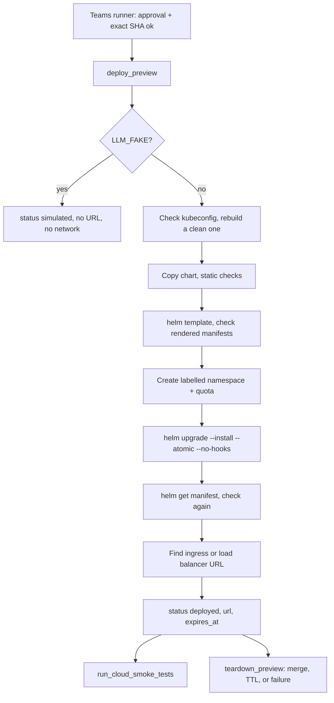

# Preview deploy adapter and release functions

Part of "Adaptive teams" step 5 (see [PLAN.md](../../PLAN.md) and
[ADAPTIVE_PARALLEL_CONTRACTS.md](ADAPTIVE_PARALLEL_CONTRACTS.md)). This note was
written before the code.

## What it does

After a second human approves, the Release Engineer's job is to put the run's
branch into a throwaway Kubernetes namespace, check it with a few HTTP requests,
and clean it up later. The adapter does the privileged part. The model never sees
credentials, and nothing in the repo is trusted.

## Rules the adapter enforces

**Credentials.** `credentials["kubeconfig"]` is plaintext only inside
`deploy/preview.py` (and its helper modules). We do not copy the user's file. We
parse it, pick one context, and write a *new* minimal kubeconfig into a private
temp folder, deleted when the call ends. Rejected: `exec`, `auth-provider`, any
`*-file` or file path field (`certificate-authority`, `client-key`, `tokenFile`),
`proxy-url`, `insecure-skip-tls-verify`, impersonation, a non-https server, a
loopback / link-local / metadata server address, and any context, cluster, or
server host that looks like production (`prod`, `production`, `prd`, `live`).
Error messages name the field, never the value. Every subprocess output is
scrubbed of the token and certificate material before it can reach an error or log.

**Names.** Namespace is `asep-preview-<run id hex>` and the Helm release is
`preview-<run id hex>`. Teardown recomputes both from `run_id` and refuses a
deployment whose namespace does not match, and refuses to delete a namespace that
lacks our labels. No code path takes a namespace from the repo or from the model.

**Untrusted chart.** The chart folder is copied (no symlinks, no junctions, size
and file-count limits) into a private folder, then checked there, so what we check
is what Helm runs. Rejected before any privileged step: `crds/`, remote or
`file://` chart dependencies, `lookup` / `getHostByName` / `.Capabilities` /
`.Release.IsUpgrade|IsInstall|Revision` in templates (cluster-dependent output
would let the install differ from the check), YAML aliases in values, oversize
files, and a `values_file` or chart path that escapes the workspace. Then
`helm template` runs with no cluster and no credentials, and the rendered
manifests must pass an allow-list: only namespaced kinds (Deployment,
StatefulSet, Job, CronJob, Service, Ingress, ConfigMap, Secret, ServiceAccount,
PersistentVolumeClaim, HPA, PodDisruptionBudget, NetworkPolicy); no Helm hooks;
no other namespace; no hostNetwork, hostPID, hostIPC, hostPath, hostPort,
privileged containers, or added capabilities; no NodePort or ExternalName
services; no service-account-token secrets; optional image registry allow-list.
External references in `values.schema.json` are rejected before rendering. The
validated output is encoded into a trusted chart that emits it literally; the
credentialed install never evaluates repository templates a second time. Install
uses `--no-hooks` and rollback on failure (`--atomic` on Helm 3,
`--rollback-on-failure` on Helm 4, detected through credential-free CLI help).
`helm get manifest` is checked afterwards. If that fails we tear the namespace
down and report failure. See the official [Helm 4 upgrade reference](https://helm.sh/docs/helm/helm_upgrade/)
and [Helm 3 upgrade reference](https://helm.sh/docs/v3/helm/helm_upgrade/).

**Commands.** Only `helm` and `kubectl`, as argument lists with fixed
subcommands, a scrubbed environment (no inherited secrets), and timeouts. Never a
shell string. Values from the repo reach Helm only as files we validated.

**Smoke tests.** Bounded: at most 10 paths, an overall deadline, a per-request
timeout, a response read cap, and at most 3 same-host redirects. Network safe:
the host is resolved once, every address must be public (private ranges only when
`PREVIEW_ALLOW_PRIVATE_SMOKE=1`), and the request is pinned to that address so DNS
rebinding cannot swap it. The chart controls the ingress host, so this is a real
SSRF guard.

**TTL and cleanup.** `expires_at = now + ttl_hours`, also written as a namespace
annotation. `teardown_preview` is idempotent. `sweep_expired_previews` finds
labelled namespaces past their expiry directly in the cluster, so TTL cleanup
works even if the database row is gone. `teardown_preview_for_run` is the hook for
PR merge cleanup. The API maintenance loop and worker schedule retry failed
cleanup and sweep organization clusters for expired namespaces, including a
namespace created just before the process crashed without saving its metadata.
Offline mode refuses to mark a real deployment deleted.

**Simulated mode.** When `LLM_FAKE` is on, `deploy_preview` returns
`status="simulated"`, `url=None`, `smoke=None`, and a stable expiry. It touches
no cluster, no network, no subprocess, no credentials. `run_cloud_smoke_tests`
in that mode sends nothing and returns `passed=False` with every check marked
`simulated: true`, because nothing was verified. The PR evidence text says
"SIMULATED" in plain words. Real mode never silently falls back to simulation: a
missing `helm`, `kubectl`, or credential gives `status="failed"` with a clear error.

## Release functions (`agents/release.py`)

* `assess_release_readiness(ws, options)` read-only, no credentials. Static chart
  checks plus `helm template` when Helm exists. The human sees this before approving.
* `run_preview_release(ws, credentials, options=..., expected_sha=..., on_event=...)`
  deploys, then smoke tests, and returns one `PreviewDeployment` with `smoke`
  set. `expected_sha` is an optional extra keyword on `deploy_preview` too: the
  workspace HEAD must start with it (at least 7 characters) and the tree must be
  committed, so the commit the human approved is the commit that ships. `on_event` gets `deploy.started` and `deploy.finished` so the runner can
  record events without this module touching the database.
* `format_deploy_evidence(deployment)` the markdown block for the PR body.
* Re-exports `teardown_preview`, `sweep_expired_previews`, `teardown_preview_for_run`.

`agents/tools.py` gains one read-only tool, `preview_check`, with no credentials
in its signature. The registry (Teams) decides whether to grant it.

## Retries and failure behaviour

* Expected failures never raise from `deploy_preview`: it returns
  `status="failed"` with a safe `error`, after removing anything it created. If
  that cleanup also fails, the error says so and the namespace keeps its expiry
  annotation, so `sweep_expired_previews` still removes it.
* `teardown_preview` raises `PreviewError` when it cannot finish, so the caller
  can retry. It never raises because something is already gone.
* Smoke checks retry transient failures (not ready, 5xx, connection errors) up to
  15 times inside their share of the deadline. A safety refusal (blocked address,
  other-host redirect) is never retried.

## Settings (read by `deploy/settings.py`, same env-file rules as the engine)

| Variable | Default | Meaning |
| --- | --- | --- |
| `PREVIEW_ALLOW_PRIVATE_SMOKE` | off | allow private-range preview URLs (in-VPC clusters) |
| `PREVIEW_ALLOW_LOCAL_CLUSTER` | off | allow a loopback API server (local minikube/kind) |
| `PREVIEW_ALLOWED_API_SERVER_HOSTS` | empty | comma list of fnmatch patterns the API host must match |
| `PREVIEW_ALLOWED_IMAGE_REGISTRIES` | empty | comma list; empty means any registry |
| `PREVIEW_HELM_TIMEOUT_SECONDS` | 300 | install / uninstall wait |

These settings are listed in `.env.example` and loaded by `deploy/settings.py`.
The production engine image includes checksum-verified Helm and kubectl. Its
`HELM_VERSION` and `KUBECTL_VERSION` build arguments permit compatible versions;
choose kubectl within one minor version of the cluster, per the
[Kubernetes installation guidance](https://kubernetes.io/docs/tasks/tools/install-kubectl-linux/).

## Not covered (must stay honest)

* No live cluster was available. The fixture chart and frozen output have been
  rendered with real Helm 4.3.1; cluster mutations and cleanup use scripted output
  in tests and still require a live sandbox-cluster check.
* The adapter does not build or push an image; `options.image` must already exist.
* Residual risk: a namespaced workload still runs the repo's code. Quota and the
  allow-list limit the blast radius; they do not make it harmless.

## Runnable check

`uv run python -m engine.deploy.check --chart ../../infra/helm/asep-preview-fixture`
runs the static checks and, when Helm is installed, the render and manifest
policy. It never contacts a cluster. Exit code 0 means the chart would be accepted.
