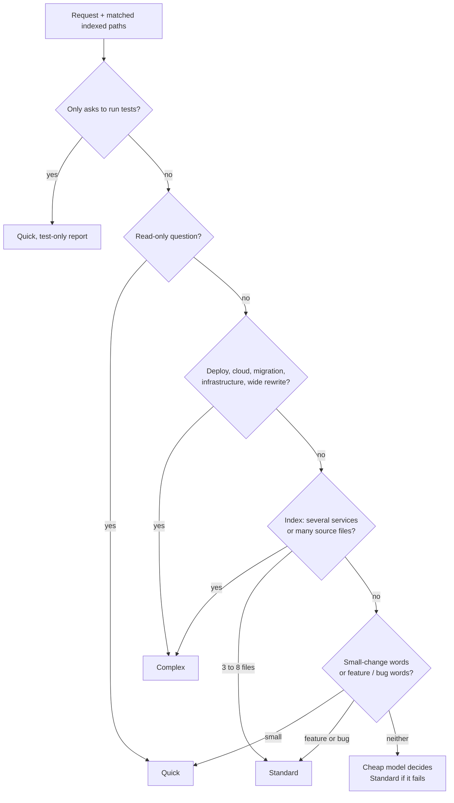

# Triage rules and the Quick team

This note covers the Triage workstream of [Adaptive Agent Teams](../../PLAN.md). It
builds on [Triage and Quick runs](TRIAGE_AND_QUICK_RUNS.md) and the shared
[parallel contracts](ADAPTIVE_PARALLEL_CONTRACTS.md). That earlier note explains
what a Quick run does after approval. This one explains how the request is sorted
in the first place, how well the sorting works, and the two team templates the
Teams workstream consumes.

## What this workstream owns

| File | Job |
|---|---|
| `agents/triage.py` | Rules, index signals, cheap-model fallback, escalation helpers |
| `agents/quick_team.py` | `quick_template(test_only)`, the two Quick team shapes |
| `agents/triage_eval.py` | Runnable accuracy check on the golden request set |
| `agents/triage_golden.json` | Labelled representative requests |
| `tests/test_triage.py`, `tests/test_quick_team.py`, `tests/test_triage_golden.py` | Tests |

It does not touch the runner, the team registry, the database, the model router,
the API or the UI. Those belong to other workstreams.

## How a request is sorted



Rules run first because they are free, instant and explainable. The model is
only asked when no rule fits, never to overrule a rule.

### What changed in the rules

- **Negation is understood.** "Run the tests, do not change anything" is still a
  test-only request. "Do not deploy yet, just add the toggle" is not Complex.
- **Test names are not work.** "Update the migration tests" mentions migration,
  but the work is a test edit, so it is Standard rather than Complex.
- **Word endings count.** "fixing", "updates", "renamed" now match as well as
  "fix", "update", "rename".
- **More infrastructure words.** Kubernetes shorthand, Helm, Pulumi, the three
  big clouds, CI/CD, "roll out to production", preview environments, schema
  changes, microservices and "across all services".
- **Test-only has more phrasings.** "Can you run the login tests", "Are the
  billing tests passing", "Which tests fail in checkout". It stays
  conservative: any editing verb that is not negated sends the request through
  a planned run instead.
- **Read-only questions are Quick.** "Explain how the retry logic works" has no
  Complex words that matter. A follow-up such as "and then fix it" cancels this.
- **Bug reports are Standard** even without the word "fix" ("login crashes when
  the password is empty").
- **Index signals ignore noise.** Docs, lock files, generated schemas, migration
  history and test files no longer inflate the file or service count. A change
  and its test file count as one thing. More monorepo roots count as services
  (`apps`, `services`, `packages`, `libs`, `modules`).
- **Search terms are better.** `scope_terms` splits `LoginForm` into `login` and
  `form`, drops more filler words, and keeps the longest (most specific) terms
  when it has to cut to 12, instead of cutting alphabetically.

Requests that stay ambiguous on purpose, such as "Improve login", go to the
cheap model. The prompt now includes counts from the index and three short
examples. If the provider fails (quota, outage) triage falls back to Standard
and the run continues, because the human still approves the plan.

## Safety rules that do not change

- Triage never grants tools, approval or publishing. Every run still waits for
  plan approval.
- A model answer can never make a request report-only. Only the rules can, and
  only when no editing verb is present.
- A human complexity override never turns a report-only request into an editing
  one: `override_decision` keeps the rules' test-only answer.
- Escalation is one step: Quick to Standard, once. Standard and Complex never
  escalate automatically. `escalate_complexity` returns `None` for them.

## Team templates

`complex` now maps to its own template name instead of `standard`; the Teams
workstream owns what that template contains.

| Template | Used when | Seats | Stages |
|---|---|---|---|
| `quick` | Quick, editing | `backend:engineer` | plan, build, sandbox, security, dependency, publish |
| `test_report` | Quick, test-only | `qa:engineer` | plan, test_report |

`template_for(complexity, test_only)` returns `test_report` for any test-only run
(even if a human raised its complexity), otherwise `quick`, `standard` or
`complex`.

The Quick editing team has one seat because one engineer plans and implements.
There is no review stage; security and dependency scans stay on because Quick
editing can still publish. The test-report team has no scan or publish stage
because nothing is published. Both functions return a fresh object each call,
so a caller can fill in a seat's `model` without changing anyone else's copy.

## How good is it?

`triage_golden.json` holds 142 labelled requests (132 scored, 10 marked
ambiguous), each with an optional list of matched index paths, in two parts:

- **dev** cases were used while tuning the rules.
- **holdout** cases were written first and were not looked at while tuning.

Run the check (no network, no model, no database):

```powershell
cd apps/engine
uv run python -m engine.agents.triage_eval              # full report
uv run python -m engine.agents.triage_eval --split holdout
uv run python -m engine.agents.triage_eval --min-accuracy 0.9   # exit 1 if lower
```

It reports overall accuracy, per-class recall, how often the rules abstained
(and so would call the cheap model), and any test-only false positives. The
cases flagged `ambiguous` must abstain; the offline score counts those as
Standard, which is what the offline fallback does.

The suite gate is: at least 90% accuracy on both splits, at least 90% recall
for each class on both splits, zero test-only false positives, and no Complex
request labelled Quick.

### Results

| | Old rules | New rules |
|---|---|---|
| All 132 scored requests | 56.8% | 100% |
| Dev (84 scored) | 56.0% | 100% |
| Holdout (48 scored) | 58.3% | 100% |
| Requests the rules decline (cheap model decides) | 40.1% | 7.0% |
| Test-only false positives | 1 | 0 |

How to read this honestly:

- The old rules declined 40% of requests. In a real run the cheap model would
  have answered those, so 56.8% understates the old setup. The comparison
  that matters is the decline rate: the new rules decide 93% of requests
  themselves, with no model call and no cost. The model's own accuracy on the
  remaining cases was not measured, because this workstream makes no live
  provider calls.
- The dev split was used while tuning, so its 100% is expected. After the first
  full run, a probe of about 50 messier requests found real gaps (UI and docs
  requests that mention "deploy" or "cloud" were Complex, plain questions about
  migration were Complex, `pytest -k login` was not recognised). The fixes and
  those probe requests were added to dev. Holdout was not changed afterwards.
- The holdout was written by the same person who wrote the rules, so it is not a
  blind test. Treat 100% as "no regression on realistic phrasings", not as a
  forecast. Expect lower accuracy on real traffic, and add misses to the golden
  file when they are seen.
- Known weak spots: "Fix the typo in deploy.sh" and "Rename deploy to release
  in the UI labels" are Complex because the word "deploy" is not recognised as a
  name; a long list of unrelated features ("add A and B and C")
  is Standard even when it is big. The human can change complexity on the
  approval screen.

## What the Teams workstream needs to know

- `template_for` can now return `"complex"`. `get_team_template("complex")` must
  exist or runs classified Complex will fail at assembly.
- `quick_template(test_only)` is complete; use `template.stages` to drive the run.
- Use `triage.escalate_complexity`, `quick_plan_needs_escalation` and
  `quick_attempts_exhausted` instead of repeating the "more than two tasks" and
  "two failed attempts" numbers in the runner.
- Use `triage.override_decision(request, complexity)` in place of the inline
  `TriageDecision(...)` construction in `_triage_run`.
- One existing test asserted a Complex run gets the `standard` template
  (`test_index_scope_integration`). It now expects `complex`.
