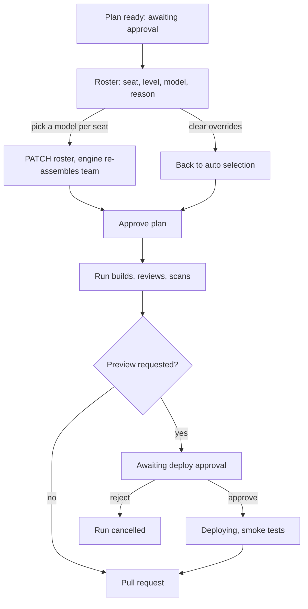

# Approval Screen: Roster, Models and Deploy Controls

**Status:** Design accepted · **Workstream:** Approval Screen Roster (Adaptive Agent Teams) · **Written:** 2026-11-17

## The problem

Adaptive teams give every run its own roster, a model per seat, and for complex
runs a design note and a preview deploy that needs a second human approval. The
engine already exposes all of it, but the run screen only shows the old plan board
and one complexity dropdown. A person approving a plan can not see who is on the
team, which model each seat will use, or why. They also can not approve the cloud
deploy, so a complex run would stop with nobody able to move it on.

## What the person sees

The run screen gains three sections.

1. **Team roster** (`TeamRoster`). A table with one row per seat showing the
   seat key (`role:level`), the role, the level, the model and the reason the
   engine gave. While the run awaits plan approval each model cell is a select.
   After approval it is read only, so the table is also the record of who used what.
2. **Design note.** The Principal Engineer's note on complex runs, shown as plain
   text once it exists.
3. **Deployment** (`DeploymentPanel`). Shows the deployment status, the preview
   URL, expiry, source commit, and the smoke test checks. While the run is
   `awaiting_deploy_approval` it also shows the second approve and reject buttons.

Each task on the board also shows its persisted level and model, because the
engine now stores both per task.

## Model choices respect the catalog

`GET /v1/models` returns the catalog. Rules the picker follows (`roster.ts`):

- Only models that support tool calls can be picked, because every seat uses tools.
- Models are sorted strongest first, then cheapest, and each option shows its
  strength and price per million tokens so the trade-off is visible.
- A model that is open source and not yet evaluated is still listed (the plan
  allows hand pinning) but is labelled "not evaluated" so nobody picks it by accident.
- A seat's current model is always kept as an option, even if the catalog no
  longer lists it, so the select never silently shows a different model.

The first option in every select is **Auto**. Choosing it removes that seat from
the override map. A **Reset all to auto** button sends an empty map, which the
engine treats as "clear overrides". The engine answers each change with the full
run detail, and the screen replaces its copy with that response, so what is shown
is always what the engine stored (including reasons like "pinned by you").

If the catalog request fails the selects stay locked and a visible error says so;
approval is still possible because auto selection does not need the catalog.

## Real versus simulated preview

The engine's preview deployment carries a status: `deployed`, `failed`, `deleted`
or `simulated`. The panel never blurs these:

| Status      | What the panel says                                                                                                                                   |
| ----------- | ----------------------------------------------------------------------------------------------------------------------------------------------------- |
| `deployed`  | Live preview, with a link to the URL                                                                                                                  |
| `simulated` | A badge "Simulated, no real cloud deploy happened". No link is made clickable even if a URL string exists, and the smoke result is labelled simulated |
| `failed`    | The error text, no link                                                                                                                               |
| `deleted`   | "Preview removed", expiry shown as history                                                                                                            |

The parsing lives in `preview.ts` and treats the payload as untrusted: unknown
fields are ignored, a URL is only linkable when it is `http` or `https` and the
status is `deployed`, and long text is truncated. Cloud credentials never come
back from the engine, so the screen has nothing to leak. It only shows whether a
cluster credential is configured.

## Backend for frontend routes

All routes use the existing `proxyToEngine` helper, so authentication, timeouts and
error shapes stay the same.

| Browser route                               | Engine route                               |
| ------------------------------------------- | ------------------------------------------ |
| `GET /api/models`                           | `GET /v1/models`                           |
| `PATCH /api/runs/{id}/roster`               | `PATCH /v1/runs/{id}/roster`               |
| `POST /api/runs/{id}/deploy-decision`       | `POST /v1/runs/{id}/deploy-decision`       |
| `GET, PUT /api/model-policy`                | `GET, PUT /v1/model-policy`                |
| `GET, PUT, DELETE /api/preview-credentials` | `GET, PUT, DELETE /v1/preview-credentials` |

The policy and credential routes are registered in the engine and generated schema. The
model policy route needs the caller's organization role in the token because
writes are admin only, so it signs `orgRole` the same way the other role-gated
routes do (`org-role.ts`).

## Settings

Two small panels join the settings page, following the provider keys panel.

- **Model policy** (`ModelPolicyPanel`): per level model pins and the "allow open
  source models in auto" switch. The engine restricts writes to owners/admins and
  shows its refusal when another member attempts a save.
- **Preview cloud access** (`PreviewCredentialPanel`): paste a kubeconfig, save,
  or remove it. The text area is cleared after saving and the panel only ever
  shows "configured" and when it was last updated. A kubeconfig is never shown back.

## Statuses, events and polling

- `StatusChip` gets colours for `awaiting_deploy_approval` and `deploying`.
- `describeEvent` gets lines for `team.updated`, `deploy.started`, `deploy.finished`,
  `deploy.approved` and `deploy.rejected`, and richer lines for `model.selected`
  and `team.assembled`. Payloads are read defensively because the deploy events are
  produced by another workstream.
- The run is live until it is completed, failed or cancelled, so the event stream
  and polling keep running while the run waits for the deploy approval.
- The diff and file panels also load in the new statuses, since the workspace exists.
- After a deploy decision the screen refetches the full run, because the engine
  returns only a short summary for that call.

## Errors

Every action shows the engine's message (`detail`) next to the control that failed:
roster changes, catalog loading, deploy decisions, policy and credential saves. The
old `decide` function swallowed failures; it now reports them too.

## Integrated contracts

`pnpm generate` includes model policy, credential metadata, typed PreviewOptions
and PreviewDeployment. Parsing remains defensive for older or incomplete records.
The deploy-decision proxy signs the caller's verified organization role so an
admin can approve another member's run.

The new-run form can infer preview intent, explicitly disable deployment, or
request a preview with chart, values, published image, lifetime and smoke paths.
The approval panel shows these settings and the checked source commit. The engine
refuses approval if the workspace is dirty or its commit changed after the checks.
